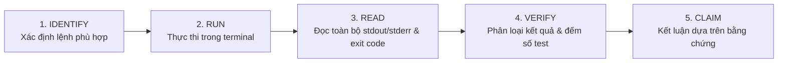

# Kỹ Năng Xác Minh Hoàn Thành Trước Khi Kết Thúc (cultivation-verify)

Kỹ năng này thiết lập và thực thi nguyên tắc cốt lõi **"Iron Law: Verification Before Completion"** cho toàn bộ các tác vụ kỹ thuật trong dự án **Vạn Kiếp · Myriad Lives**.

> **NGUYÊN TẮC BẤT DI BẤT DỊCH (THE IRON LAW):**  
> Tuyệt đối không tuyên bố hoàn thành nhiệm vụ, không khẳng định bản sửa đổi hoạt động tốt, và không kết luận code sẵn sàng cho PR nếu chưa thực sự thực thi các lệnh kiểm thử và đọc trực tiếp kết quả đầu ra (output) từ lần chạy hiện tại.

---

## 1. Mục Đích & Phạm Vi Áp Dụng

Mỗi khi một agent chuẩn bị:
- Kết luận đã hoàn thành một yêu cầu sửa lỗi hoặc tính năng mới,
- Báo cáo kết quả kiểm thử cho người dùng,
- Chuẩn bị tạo hoặc cập nhật Pull Request,

Agent **bắt buộc** phải kích hoạt quy trình xác minh 5 bước của kỹ năng này để thu thập bằng chứng thực tế, thay vì dựa vào giả định hoặc kết quả từ các phiên làm việc trước đó.

---

## 2. Quy Trình Cổng Kiểm Tra 5 Bước (The 5-Step Verification Gate)



### Bước 1: IDENTIFY — Xác định Lệnh Kiểm Thử Phù Hợp
Xác định chính xác các tệp đã bị thay đổi thông qua `git status --short` và `git diff --name-only` để chọn lệnh kiểm thử tương ứng:

1. **Khi có thay đổi mã nguồn ứng dụng, giao diện, dữ liệu game hoặc bộ test (`src/`, `public/`, `tests/`, `package.json`):**
   - **Lệnh chuẩn duy nhất:** `npm test`
   - *Lưu ý tối ưu tài nguyên:* Theo định nghĩa trong `package.json`, `npm test` đã tự động bao gồm chuỗi `npm run build && node tests/suite.js && node tests/test_migration.js`. Vì vậy, **không chạy lệnh `npm run build` riêng lẻ ngay trước `npm test`** để tránh lãng phí thời gian và build trùng lặp không cần thiết.
   - *Trường hợp ngoại lệ:* Chỉ chạy riêng `npm run build` khi cần xác minh lỗi cú pháp bundle Vite độc lập trong môi trường không có Google Chrome/Puppeteer.
2. **Khi chỉ thay đổi tài liệu, kỹ năng hoặc cấu hình quy trình (`.md`, `docs/`, `.agents/`):**
   - **Không bắt buộc working tree phải sạch hoàn toàn (Clean Working Tree):** Nhận diện rằng dự án có thể chứa các tệp kiểm toán nội bộ untracked, CSV tham chiếu hoặc thay đổi chưa commit có sẵn của người dùng.
   - **Quy tắc so sánh trạng thái Git ban đầu và cuối cùng:** Ghi nhận `git status --short --untracked-files=all` (hoặc `git status -s -uall`) trước và sau khi thực hiện công việc để liệt kê rõ ràng từng tệp untracked cụ thể bên dưới các thư mục con (không chỉ dựa vào dấu `??` ở cấp thư mục). Đảm bảo:
     - Các tệp untracked và thay đổi có sẵn được bảo toàn nguyên vẹn (không xóa, không di chuyển, không đổi tên).
     - Không có tệp mã nguồn ứng dụng (`src/`, `public/`, `tests/`) bị chỉnh sửa ngoài ý muốn.
     - Chỉ có các tệp tài liệu/kỹ năng trong phạm vi được phép là có thay đổi.
   - **Kiểm tra tính hợp lệ của tài liệu và kỹ năng:**
     - Kiểm tra cú pháp YAML frontmatter trên đĩa (delimiter `---`, trường `name`, `description`).
     - Kiểm tra tính toàn vẹn của các liên kết Markdown tương đối (relative links), đảm bảo mọi đường dẫn đích đều tồn tại trên hệ thống tệp.
     - Kiểm tra định dạng finding (đầy đủ 6 phần theo [`AGENTS.md`](../../../AGENTS.md)).
   - *Lưu ý về kiểm thử ứng dụng:* Không chạy `npm test` lặp lại nếu không có lý do kỹ thuật cụ thể hoặc không có thay đổi mã nguồn/test.
3. **CẢNH BÁO MÔI TRƯỜNG NODE.JS (Theo [`AGENTS.md`](../../../AGENTS.md) Mục 6):**
   - Tuyệt đối không chạy lệnh `node -e 'import("./src/main.js")'` vì `src/main.js` phụ thuộc vào các đối tượng trình duyệt (`window`, `document`) và sẽ gây lỗi crash `ReferenceError: document is not defined`.

### Bước 2: RUN — Thực Thi Lệnh Trong Terminal
- Thực thi lệnh bằng công cụ dòng lệnh với tham số thời gian chờ (`WaitMsBeforeAsync`) phù hợp để đảm bảo lệnh kết thúc hoàn toàn (ví dụ: `npm test` thường mất 5-15 giây).
- Ghi nhận mã thoát (`exit code`) trả về từ tiến trình.

### Bước 3: READ — Đọc và Phân Tích Toàn Bộ Output
- Đọc kỹ toàn bộ văn bản đầu ra (`stdout` và `stderr`). Tuyệt đối không chỉ nhìn vào exit code 0 mà bỏ qua nội dung log.
- **Trích xuất số lượng test thực tế được thực thi trong lần chạy này:**
  - Đọc trực tiếp từ log của `tests/suite.js` (ví dụ: `PASS: 15 passed, 0 failed`).
  - Đọc trực tiếp từ log của `tests/test_migration.js` (ví dụ: `PASS: 2 passed, 0 failed`).
  - **TUYỆT ĐỐI KHÔNG HARDCODE** tổng số test là 17. Con số báo cáo phải là con số thực tế được đếm và xác nhận từ output của lần chạy hiện tại.
- **Kiểm tra tiêu chí mạng và tài sản ngoại vi:**
  - Xác nhận Puppeteer báo cáo 0 runtime external network request.
  - Xác nhận các tệp font cục bộ tải thành công từ `/fonts/`.

### Bước 4: VERIFY — Phân Loại Trạng Thái Kiểm Thử
Phân định rạch ròi 4 trạng thái kiểm thử, không đánh đồng:
1. **ĐÃ CHẠY (PASSED):** Các ca kiểm thử đã thực sự chạy trong tiến trình và cho kết quả thành công.
2. **THẤT BẠI (FAILED):** Các ca kiểm thử đã chạy nhưng gặp lỗi (assertion failure, crash, exception).
3. **BỊ CHẶN (BLOCKED):** Không thể thực thi kiểm thử do thiếu điều kiện tiên quyết (ví dụ: thiếu Google Chrome trên hệ thống, thiếu dependencies, lỗi cổng mạng).
4. **CHƯA CHẠY (NOT RUN / SKIPPED):** Các kịch bản kiểm thử không nằm trong phạm vi của lệnh vừa chạy hoặc bị bỏ qua.

### Bước 5: CLAIM — Đưa Ra Tuyên Bố Dựa Trên Bằng Chứng
- **Chỉ công bố hoàn thành (Verified Pass)** khi:
  - Lệnh kiểm thử kết thúc với exit code `0`.
  - 100% các bài test trong bộ kiểm thử mục tiêu thuộc trạng thái `ĐÃ CHẠY (PASSED)`.
  - Không có cảnh báo bất thường hoặc lỗi tiềm ẩn trong log.
- **Nếu có test THẤT BẠI hoặc BỊ CHẶN:**
  - Báo cáo trung thực tình trạng lỗi, trích dẫn chính xác stack trace và thông báo lỗi.
  - Tuyên bố rõ ràng nhiệm vụ **CHƯA HOÀN THÀNH** và chỉ ra nguyên nhân gây lỗi để tiếp tục khắc phục.

---

## 3. Mẫu Báo Cáo Xác Minh (Verification Evidence Report)

Mỗi lần thực thi xác minh, agent phải đính kèm báo cáo bằng chứng theo cấu trúc chuẩn sau:

```markdown
### Báo Cáo Xác Minh Thực Tế (Verification Evidence)

- **Lệnh thực thi:** `<command line, ví dụ: npm test>`
- **Thư mục làm việc:** `<working directory>`
- **Mã thoát (Exit Code):** `<0 hoặc mã lỗi>`
- **Tổng kết kiểm thử lần chạy này:**
  - **Đã chạy và Thành công (Passed):** `<N>` bài test (gồm `<X>` E2E trình duyệt + `<Y>` migration dữ liệu lưu)
  - **Thất bại (Failed):** `<0 hoặc số lượng>` bài test
  - **Bị chặn (Blocked):** `<0 hoặc lý do nếu có>`
  - **Chưa chạy (Not run):** `<danh sách phạm vi không chạy nếu có>`
- **Bằng chứng trích xuất từ log (Raw Excerpts):**
  ```text
  [Trích dẫn 3-5 dòng log then chốt chứng minh kết quả thực tế từ stdout]
  ```
- **Kiểm tra tài nguyên & mạng:** `0 external requests` (hoàn toàn offline), font tải thành công từ `/fonts/`.
- **Kết luận:** `[VERIFIED PASS | VERIFIED FAIL | VERIFIED BLOCKED]`
```
