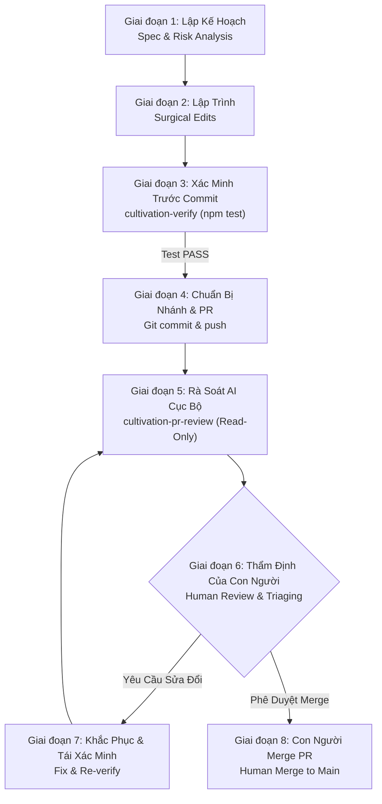

# Quy Trình Phát Triển & Rà Soát Mã Nguồn Cục Bộ (DEVELOPMENT_WORKFLOW.md)
**Dự án:** Vạn Kiếp · Myriad Lives  
**Phạm vi:** Dành cho các nhà phát triển, cộng tác viên kỹ thuật và AI Coding Agents trong repository.

---

## 1. Tổng Quan & Triết Lý Quy Trình

Dự án *Vạn Kiếp · Myriad Lives* áp dụng quy trình phát triển và rà soát mã nguồn khép kín, độc lập và có tính tái lập cao. Mục tiêu cốt lõi là **thay thế hoàn toàn sự phụ thuộc vào các bot review bên ngoài (như GitHub Codex review bot)** bằng các kỹ năng rà soát nội bộ chạy cục bộ trên môi trường của lập trình viên và Antigravity AI Agents.

### Quy Trình Vòng Đời 8 Giai Đoạn (The 8-Stage Lifecycle)



---

## 2. Chi Tiết Các Giai Đoạn Trong Quy Trình

### Giai đoạn 1: Lập Kế Hoạch & Khảo Sát (Planning & Risk Analysis)
- Đọc kỹ [README.md](../README.md) và tiêu chuẩn kỹ thuật trong [AGENTS.md](../AGENTS.md).
- Kiểm tra trạng thái Git hiện tại (`git status --short`) để đảm bảo không xóa hoặc ghi đè các thay đổi chưa commit của người dùng.
- Xác định phạm vi ảnh hưởng: Có chạm vào source bundle đơn khối `src/main.js`, cấu trúc save game (`localStorage`), hay hệ thống font offline không?
- Lập kế hoạch can thiệp vi mô (surgical edits) thay vì tái cấu trúc diện rộng.

### Giai đoạn 2: Lập Trình & Can Thiệp Vi Mô (Implementation)
- Thực hiện các sửa đổi nhỏ nhất đáp ứng yêu cầu.
- Tuân thủ nghiêm ngặt quy tắc đối với `src/main.js` (~12.6MB, 8 dòng):
  - Định vị bằng chuỗi ổn định (tên hàm, ID sự kiện như `sparse_mortal_granary_raiders`).
  - Tuyệt đối không prettify hoặc format toàn bộ file bundle.
  - Bảo toàn toàn bộ các biến nội suy (`${o}`, `${i}`) và ký hiệu đặc biệt (`·`, `✦`, `±`).

### Giai đoạn 3: Xác Minh Trước Commit (Pre-Commit Verification via `cultivation-verify`)
- Kích hoạt kỹ năng [`.agents/skills/cultivation-verify`](../.agents/skills/cultivation-verify/SKILL.md) tuân thủ nguyên tắc **"Iron Law: Verification Before Completion"**.
- Chạy lệnh kiểm thử tiêu chuẩn:
  ```bash
  npm test
  ```
  *(Lưu ý: Lệnh này đã bao gồm `npm run build && node tests/suite.js && node tests/test_migration.js`. Không chạy `npm run build` riêng lẻ trước đó).*
- Đọc toàn bộ output thực tế, trích xuất số lượng test thực tế (không hardcode) và xác minh:
  - 100% test E2E trình duyệt và test migration đều đạt (PASS).
  - 0 external runtime network requests (hoàn toàn offline).
  - Font OFL tải thành công từ `/fonts/`.

### Giai đoạn 4: Chuẩn Bị Nhánh & Pull Request (Branch & PR Preparation)
- Đặt tên nhánh rõ ràng theo loại công việc (ví dụ: `feat/new-realm`, `fix/granary-event`).
- Tạo commit có thông điệp theo chuẩn Conventional Commits (ví dụ: `fix: correct death branch in granary raiders`).
- Đẩy nhánh lên remote và tạo PR trên GitHub:
  ```bash
  git push -u origin <branch-name>
  gh pr create --base main --head <branch-name> --title "..." --body "..."
  ```

### Giai đoạn 5: Rà Soát AI Cục Bộ (Local AI Review via `cultivation-pr-review`)
- Kích hoạt kỹ năng [`.agents/skills/cultivation-pr-review`](../.agents/skills/cultivation-pr-review/SKILL.md).
- Kỹ năng hoạt động ở chế độ **CHỈ ĐỌC (STRICTLY READ-ONLY)**, tự động lấy diff giữa `origin/main` và nhánh hiện tại:
  ```bash
  git diff origin/main...HEAD
  ```
- Rà soát dựa trên 7 vùng rủi ro trọng tâm và lập báo cáo theo cấu trúc 6 phần bắt buộc của [AGENTS.md](../AGENTS.md).
- Đưa ra kết luận khách quan: `READY`, `READY WITH NON-BLOCKING NOTES`, `CHANGES REQUIRED`, hoặc `REVIEW BLOCKED`.

### Giai đoạn 6: Thẩm Định Của Con Người (Human Review & Triaging)
- Nhà phát triển/người dùng đọc báo cáo rà soát của AI.
- Quyết định xử lý:
  - Nếu kết luận là `READY` hoặc `READY WITH NON-BLOCKING NOTES` và người dùng hài lòng: Chuyển sang Giai đoạn 8.
  - Nếu có phát hiện `CHANGES REQUIRED` (P0/P1/P2): Người dùng phê duyệt phương án khắc phục tối thiểu.

### Giai đoạn 7: Khắc Phục & Tái Xác Minh (Remediation & Re-Verification)
- Agent hoặc lập trình viên thực hiện sửa đổi tối thiểu theo phương án đã duyệt.
- Chạy lại kỹ năng `cultivation-verify` (`npm test`) để lấy bằng chứng xác minh mới nhất.
- Đẩy commit mới lên nhánh PR và chạy lại `cultivation-pr-review` để đảm bảo lỗi đã được giải quyết triệt để và không phát sinh lỗi mới.

### Giai đoạn 8: Con Người Quyết Định Merge (Human Merge Decision)
- **Quyền quyết định tối cao luôn thuộc về con người.** AI agents không bao giờ tự ý merge PR.
- Người dùng thực hiện merge PR trên GitHub UI hoặc qua GitHub CLI:
  ```bash
  gh pr merge <pr-number> --squash
  ```

---

## 3. Hướng Dẫn Sử Dụng Multi-Agent Teamwork (`/teamwork-preview`)

Trong Antigravity, bạn có thể tận dụng tính năng `/teamwork-preview` để phối hợp nhiều subagent chuyên biệt cùng giải quyết một tác vụ lớn.

### Khi nào nên sử dụng Teamwork?
- **Phù hợp:**
  - Tác vụ quy mô lớn: Bổ sung cảnh giới mới, mở rộng hệ thống sự kiện hàng loạt, hoặc tái cấu trúc logic tính toán phức tạp.
  - Phân tách vai trò độc lập:
    - *Agent Nghiên cứu (Research Agent):* Khảo sát cấu trúc sự kiện, dò tìm khóa `De`/`Ee` liền kề.
    - *Agent Lập trình (Coding Agent):* Thực hiện can thiệp vi mô vào `src/main.js`.
    - *Agent Rà soát (Review Agent):* Chạy `cultivation-pr-review` độc lập, đóng vai trò "ác quỷ phản biện" (devil's advocate) mà không bị ảnh hưởng bởi thiên kiến của Agent lập trình.
- **Không nên sử dụng (Ưu tiên Single-Agent):**
  - Vá lỗi nhỏ, chỉnh sửa vài từ ngữ localization, cập nhật tài liệu hoặc chỉnh sửa một hàm toán học đơn lẻ. Sử dụng multi-agent cho các việc nhỏ sẽ gây lãng phí context và chậm tiến độ.

### Nguyên Tắc Bắt Buộc Khi Dùng Teamwork:
1. **Kiểm thử độc lập:** Teamwork không thay thế bộ test. Kết quả cuối cùng của bất kỳ nhóm subagent nào vẫn bắt buộc phải vượt qua cổng kiểm tra `cultivation-verify` (`npm test`).
2. **Quyền hạn rạch ròi:** Review Agent trong nhóm teamwork phải tuân thủ nghiêm ngặt chế độ Read-Only, không được tự ý ghi đè mã nguồn do Coding Agent vừa viết mà chỉ được báo cáo finding.

---

## 4. Hướng Dẫn Gọi Kỹ Năng Bằng Slash Commands & Lệnh Nhanh

Trong môi trường Antigravity IDE hoặc CLI:

### 1. Kích hoạt Xác Minh Trước Khi Hoàn Thành:
Khi muốn xác minh mã nguồn hiện tại:
> *"Hãy chạy kỹ năng `cultivation-verify` để kiểm tra toàn bộ mã nguồn và báo cáo số lượng test thực tế."*

### 2. Kích hoạt Rà Soát Pull Request Cục Bộ:
Khi đã push nhánh hoặc chuẩn bị PR:
> *"Hãy kích hoạt kỹ năng `cultivation-pr-review` để rà soát diff của nhánh hiện tại so với `origin/main` và xuất báo cáo theo chuẩn AGENTS.md."*

---

## 5. Bảng Tra Cứu Lệnh Nhanh (Cheatsheet)

| Tác vụ | Lệnh thực thi | Ghi chú an toàn |
| :--- | :--- | :--- |
| **Kiểm tra trạng thái** | `git status --short` | Không làm mất tệp untracked |
| **Xem diff nhánh PR** | `git diff origin/main...HEAD` | Kiểm tra phạm vi thực tế |
| **Kiểm thử toàn diện** | `npm test` | Bao gồm build + 15 browser tests + 2 migration tests |
| **Kiểm tra cú pháp build** | `npm run build` | Chỉ chạy độc lập khi không có Chrome |
| **Chạy dev server** | `npm run dev` | Xem trước UI cục bộ tại `localhost:5173` |
